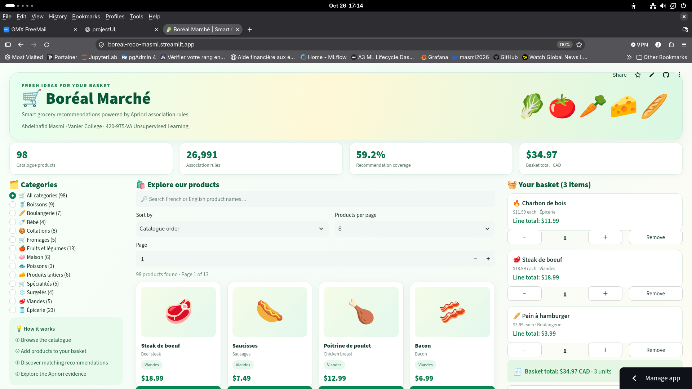
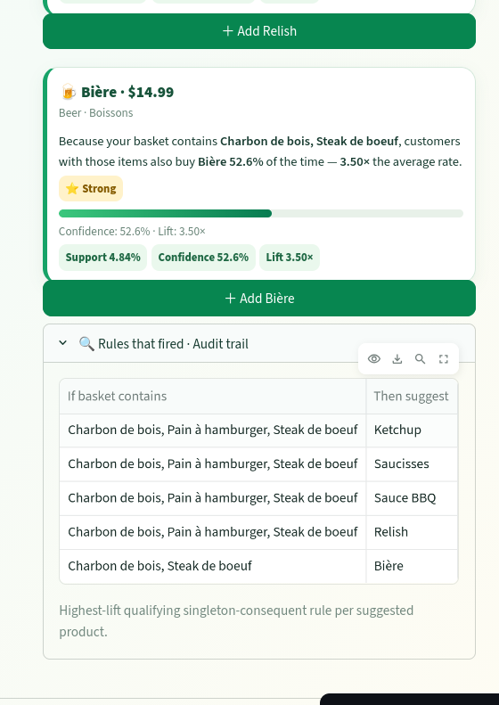

# Boréal Marché — Apriori Recommendation Engine

**Vanier College — 420-975-VA: Unsupervised Learning**

**Author:** Abdelhafid Masmi

## Project Overview

A grocery recommendation system using association rule mining
with Apriori (mlxtend).

The system analyzes 1,000,000 shopping baskets and 98 products
to recommend items based on basket contents.

## Technologies

- Python 3.12
- Pandas
- mlxtend (Apriori)
- Jupyter Notebook
- Streamlit

## Project Structure

- `notebooks/` — Data analysis and Apriori mining
- `models/` — Exported rules and metadata
- `app/` — Streamlit recommendation application
- `reports/` — Performance benchmarks
- `data/` — Local datasets (excluded from Git)

## Current Results

- Transactions: 8,379,837
- Shopping baskets: 1,000,000
- Products: 98
- Generated rules: 26,991 (lift > 1)
- Recommendation coverage: 59.2%

## Status

Streamlit application implemented and tested locally.

## Data

The original transaction dataset is excluded from GitHub
because of its size. Place the original datasets in data/ to reproduce the mining notebook.

## Limitations

Apriori can be memory-intensive on large datasets.
Rare products may not appear in recommendations because
they do not meet the minimum support threshold.

## Installation

Requires Python 3.12.

Install dependencies:

    python -m pip install -r requirements.txt

Run Streamlit:

    streamlit run app/streamlit_app.py

## Features

- Catalogue of 98 products
- Basket with quantities and prices
- Apriori recommendations with support, confidence and lift
- Popular-product fallback
- Recommendation audit trail

## Notebook

notebooks/masmi-notebook.ipynb

## Benchmark

reports/benchmark.md

## Application Screenshots

### Main application
Catalogue, product categories, shopping basket, and project statistics.

### Apriori recommendations and rule evidence
Recommendations with support, confidence, lift, and the fired-rules audit trail.

